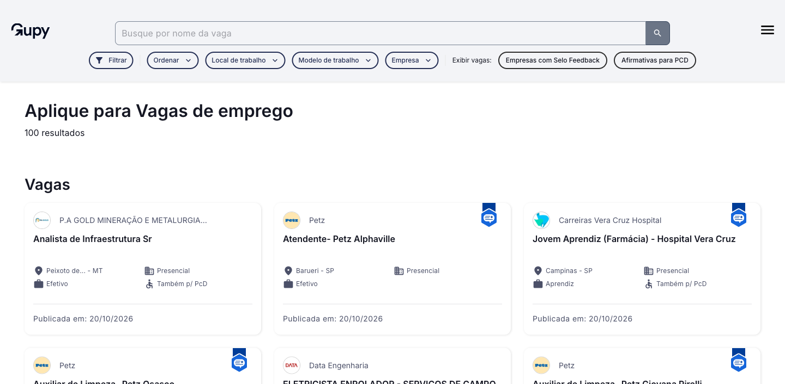
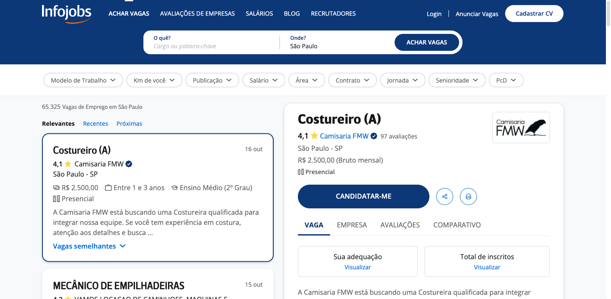
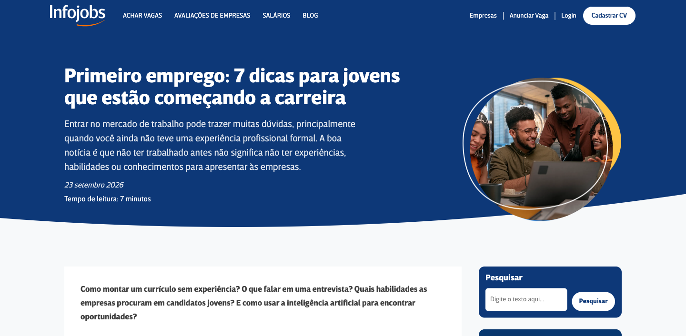

# Gupy e Infojobs: análise de design para o EmpregaSantana

**Data:** 20/10/2026. **Entrega:** estudo de referências e recomendação de experiência por tela. **Direção confirmada:** site e sistema em modo claro, com a identidade azul/laranja do EmpregaSantana. As propostas deste documento não alteram o escopo aprovado do MVP nem representam telas já implementadas.

## 1. Recomendação principal

A home pública apresenta o projeto como um pitch, conforme a direção posterior confirmada pelo responsável a partir do FinGestão. Dentro da área de oportunidades, combinar a organização por tarefa do portal da Gupy com a busca por cargo e localização do Infojobs. O conteúdo editorial ajuda a orientar; o painel autenticado ajuda a concluir e acompanhar as ações.

A marca permanece a do EmpregaSantana: Montserrat nos títulos, Poppins no corpo, página `#F8F8F8`, superfícies brancas, apoio `#F2F2F2`, texto `#333333`, azul `#1E63B6` e laranja de ação `#FF8A00`, conforme [identidade visual](IDENTIDADE_VISUAL.md). Os heros escuros das referências não são a direção aprovada para o projeto.

## 2. Como as referências foram examinadas

Navegação pública com Playwright e Chrome, inspeção de screenshots e snapshots, consulta a fontes oficiais e confronto com o código do projeto. Não houve criação de conta, envio de currículo, candidatura ou acesso a painéis privados. O estudo não atribui notas de auditoria e não executa o fluxo formal `impeccable critique`.

É necessário distinguir quatro contextos da Gupy:

| Contexto | Público e objetivo | Fonte |
|---|---|---|
| Portal de vagas | Pessoa candidata procura oportunidades | [portal.gupy.io](https://portal.gupy.io/) |
| Página de carreira de uma empresa | Pessoa conhece uma empresa e suas vagas | [Exemplo: carreira da própria Gupy](https://vempra.gupy.io/) |
| Site comercial | Equipe de RH avalia a contratação do software | [gupy.io](https://www.gupy.io/) |
| Blogs | Orientação de carreira para candidatos; conteúdo de RH para empresas | [Blog do Emprego](https://www.gupy.io/blog-do-emprego), [Blog de RH](https://www.gupy.io/blog/all) |

A home comercial de um fornecedor de RH não deve virar o modelo da home de quem procura emprego. Essa distinção evita priorizar demonstração comercial, promessas de IA ou grandes indicadores antes da busca.

No Infojobs, o site de vagas e o blog mantêm caminhos para candidatos e recrutadores. As fontes principais são a [home](https://www.infojobs.com.br/), a [busca pública](https://www.infojobs.com.br/empregos.aspx), o [blog](https://blog.infojobs.com.br/) e a [entrada para empresas](https://www.infojobs.com.br/anunciar-vaga-de-emprego-gratis.aspx).

As páginas podem mudar por dispositivo, cookies, localização e sessão. Contagens, vagas e preços vistos nas referências são dados transitórios; não são parâmetros nem evidência de desempenho do EmpregaSantana. A cobertura visual e as limitações de acesso ficam registradas no fim deste documento.

## 3. Linguagem visual e composição

As observações abaixo descrevem as páginas inspecionadas, não um manual oficial de marca dos concorrentes. Valores exatos de fontes, raio e espaçamento não foram extraídos dos seus arquivos de design.

| Aspecto | Gupy | Infojobs | Aplicação recomendada |
|---|---|---|---|
| Composição | Busca com navegação compacta; listagem em cards; páginas de carreira com capa e identidade da empresa | Home com busca muito destacada; listagem reúne várias informações por oportunidade | Home simples; busca com contexto regional; resultados que permitam comparar rapidamente |
| Cor | Portal combina branco/cinza claro com azul profundo; blog usa áreas de azul intenso | Azul institucional organiza a home e as ações; conteúdo e resultados sobre superfícies claras | Fundos claros em todas as áreas; azul para navegação e foco; laranja para a ação prioritária |
| Tipografia | Títulos de seção grandes e diferença visível entre título, metadado e descrição | Hierarquia direta entre cargo, empresa, localização e informações de decisão | Preservar Montserrat/Poppins; título do cargo deve ser mais forte que chips e rótulos |
| Forma | Campos e controles arredondados; filtros compactos; cards com separação suave | Busca agrupada em um bloco evidente e elementos repetidos para comparação | Manter raio de cards de 12–16 px e botões existentes; evitar colocar todo texto dentro de cards |
| Imagem | Pessoas no blog, capa em página de carreira, logos nos resultados | Logos e conteúdo editorial apoiam a confiança e a orientação | Fotos reais e autorizadas da região quando disponíveis; logo da empresa em dimensão estável |
| Densidade | Portal oferece poucos filtros em destaque e mais opções em controles próprios | Busca pública expõe taxonomia ampla, remuneração, experiência e modalidade | Mostrar filtros essenciais primeiro; opções adicionais sob “Mais filtros” |
| Ação | A tarefa muda conforme o contexto: buscar, candidatar-se ou ler | Busca e cadastro de currículo permanecem acessíveis no ecossistema | Um CTA principal por seção; ações secundárias com menor destaque |

**Decisão prática:** padronizar componentes e hierarquia entre as áreas, mas adequar a composição à tarefa. A home apresenta caminhos; a listagem permite comparar; o detalhe explica; o formulário coleta; o painel organiza trabalho; o artigo facilita leitura. Repetir o mesmo conjunto de cards em todas essas situações prejudicaria essa distinção.

## 4. Home: funcionamento e proposta

### O que as referências fazem

Na home do [Infojobs](https://www.infojobs.com.br/), a busca separa cargo/palavra-chave e localização. Abaixo dela, empresas e áreas profissionais criam caminhos alternativos para descobrir oportunidades. Na [home do Portal Gupy](https://portal.gupy.io/), a busca é acompanhada da opção de explorar as vagas; navegação e seções também conduzem a currículo, orientação e ajuda.

### Como deve funcionar no EmpregaSantana

O levantamento inicial sugeriu a sequência abaixo. A decisão posterior do responsável substituiu a busca como foco da abertura por uma apresentação em formato de pitch (ver §16 e [protótipos](PROTOTIPOS.md)). A busca permanece na área de oportunidades.

Sequência levantada antes dessa atualização:

1. **Cabeçalho:** marca, Vagas, Autônomos, Dicas de carreira e uma entrada discreta Para empresas; Entrar acessível. “Dicas de carreira” depende da entrega real do blog.
2. **Abertura curta:** título regional direto, como “Encontre trabalho e profissionais em Santana e região”. É proposta de texto, sem substituir automaticamente a tagline oficial.
3. **Busca:** cargo ou serviço e cidade; a localização sugerida precisa estar visível e editável. O tipo de busca deve ser explícito: Vagas ou Autônomos.
4. **Oportunidades recentes:** vagas publicadas, com cidade, contratação e remuneração divulgada. Contagens reais ou ausência de contagem enquanto carrega.
5. **Profissionais da região:** serviço, nome, área de atendimento e forma de cobrança. Evitar misturar vaga CLT e serviço avulso sem identificação.
6. **Empresas com vagas abertas:** mostrar somente empresas que correspondam à afirmação. O perfil público continua acessível, respeitando a regra atual de que o diretório completo exige login.
7. **Orientação:** até três artigos úteis quando houver conteúdo publicado; sem uma seção vazia para preencher o layout.
8. **Convite para empresas e autônomos:** publicar vaga ou divulgar perfil, com condições reais de acesso.
9. **Rodapé:** sobre, ajuda, termos, privacidade e LGPD; contatos apenas quando confirmados.

Para a pessoa logada, reduzir a apresentação institucional e priorizar busca e atalhos de seu papel: candidaturas, currículos, perfil profissional ou gestão de vagas. Evitar afirmar que o feed é personalizado se ele não tiver uma lógica real de personalização.

**Confronto com o projeto:** `HomePage.tsx` já oferece busca, contagens, filtros e feed combinado; `FeaturedCarousel` disputa espaço com resultados. Recomenda-se dar prioridade à busca e separar melhor vagas de serviços, mantendo os recursos existentes. O cabeçalho atual torna “Entrar” a ação laranja; rever essa prioridade junto ao CTA principal da página.

## 5. Busca e resultados

A [busca do Infojobs](https://www.infojobs.com.br/empregos.aspx) expõe filtros por remuneração, data, modalidade, área e contratação. A [busca do Portal Gupy](https://portal.gupy.io/job-search/sortBy=publishedDate) agrupa filtros em controles como ordenar, local, modelo e empresa, com cards de oportunidades. No desktop examinado, o Infojobs também mostra lista e detalhe lado a lado, enquanto a Gupy apresenta uma grade de cards. O primeiro favorece comparação com prévia da vaga; o segundo apresenta uma seleção mais sintética.

Para o EmpregaSantana:

- Manter termo, cidade, tipo de resultado, ordenação e filtros na URL, para compartilhar a busca e voltar do detalhe sem perder contexto.
- No desktop, filtros laterais e resultados em lista ou grade moderada. Para vagas, testar uma lista mais compacta antes de adotar pré-visualização em duas colunas; para serviços, fotos de portfólio podem justificar a grade.
- No celular, busca legível, resumo dos filtros aplicados e painel de filtros com Aplicar e Limpar. Fechar devolve o foco ao botão que abriu o painel.
- Começar com cidade, categoria, contratação e remoto. Salário e data entram quando a consulta e os dados suportarem o comportamento prometido.
- Card de vaga: cargo → empresa → cidade/modalidade → contratação/remuneração → publicação. Resumo curto sempre acessível, sem depender de hover.
- Card de autônomo: serviço → profissional → região atendida → cobrança → disponibilidade informada. Deixar claro quando o preço depende de orçamento.
- Distinguir carregar, falhar, não encontrar e terminar os resultados. “Tentar novamente” mantém a busca; “Limpar filtros” explica o que remove.

`ExplorarPage.tsx` hoje persiste apenas o termo `q`; `FeedFilterPanel` não oferece cidade; `filterAutonomos` não aplica `remoteOnly`. Isso precisa ser resolvido antes de apresentar filtros mais sofisticados. Em escala, busca, filtros, contagem e paginação devem usar o mesmo critério no servidor; a grade local não deve insinuar que contém todo o catálogo.

## 6. Detalhe da vaga e candidatura

O [exemplo do Infojobs](https://www.infojobs.com.br/vaga-de-costureiro-a-em-sao-paulo__11894157.aspx) reúne empresa, local, remuneração e candidatura no início, com descrição e exigências abaixo. O [exemplo público da Gupy](https://vempra.gupy.io/jobs/12424148?jobBoardSource=gupy_public_page) divide o conteúdo em descrição, responsabilidades, requisitos, informações adicionais e etapas. Essas etapas pertencem à vaga examinada e não são uma regra para todas as empresas da plataforma.

Estrutura recomendada:

| Região da tela | Conteúdo e comportamento |
|---|---|
| Retorno | Voltar aos resultados conservando busca, filtros e posição |
| Resumo | Cargo, empresa vinculada, cidade, modalidade, contratação, faixa divulgada e data |
| Ação | Candidatar-se; depois de enviada, indicar o estado real e oferecer Ver candidatura |
| Conteúdo | Sobre a vaga, atividades, requisitos e benefícios quando cadastrados |
| Empresa | Resumo curto e link para página pública, sem repetir toda a apresentação institucional |
| Orientação | Explicar próximos passos e os dados que serão enviados |
| Fim | Outras oportunidades apenas se houver critério real de relação |

Em celular, considerar uma barra inferior de candidatura que não cubra conteúdo, teclado nem rodapé. No desktop, um resumo lateral pode acompanhar a leitura. São propostas para validar, não comportamentos presumidos das referências.

Fluxo proposto: vaga pública → login/cadastro apenas ao agir → retorno à vaga → escolha de currículo → revisão → envio → confirmação com cargo e currículo → minhas candidaturas. Sem currículo, oferecer Criar currículo e preservar a intenção. Se a pessoa já se candidatou, informar se um novo envio atualiza o currículo, em vez de aparentar nova candidatura.

**Lacunas no código:** `CandidaturasPage.tsx` seleciona currículo e faz upsert, mas não apresenta erro de envio nem confirmação explícita; sem currículo, mostra orientação sem link de criação. Carregamento de currículos também não deve ser confundido com ausência de currículo. O desenho precisa contemplar esses estados, não apenas a tela preenchida.

## 7. Empresas e perfil do autônomo

A página de carreira examinada na Gupy usa capa, marca, apresentação e acesso às vagas. O [perfil de empresa do Infojobs](https://www.infojobs.com.br/empresa-camisaria-fmw__-418133.aspx) reúne informações e reputação no seu ecossistema. Reputação e depoimentos exigem dados próprios; não devem aparecer como componentes decorativos no EmpregaSantana.

Para `/empresas/:id`, organizar logo, nome, setor, local e verificação real no início; oferecer acesso imediato a Vagas abertas e Sobre. A capa é opcional e não deve empurrar a lista de vagas para muito abaixo. Fotos do ambiente e informações institucionais entram quando cadastradas e autorizadas. O projeto já tem campos de visibilidade para parte desses dados; a interface deve respeitá-los. Sem vagas abertas, mostrar um estado honesto, sem botões de candidatura inoperantes.

Autônomos precisam de um desenho próprio, pois a tarefa é contratar um serviço. Em `/autonomos/:id`, priorizar o que a pessoa faz, onde atende, sua disponibilidade, modalidade de cobrança, portfólio e contato. Um perfil de eletricista não deve parecer uma vaga publicada por uma empresa. A inspiração das referências é a clareza da identidade e da ação, não a cópia integral da página de carreira.

## 8. Cadastro, login e área do candidato

**Observação pública:** a Gupy apresenta cadastro em coluna central com explicação de campos e ação de continuidade. O cadastro do Infojobs combina apresentação lateral e formulário, além de provedores de acesso. Esses provedores são recursos próprios das referências; não significam que já existam no EmpregaSantana. Fontes: [cadastro Gupy](https://login.gupy.io/candidates/signup) e [cadastro Infojobs](https://login.infojobs.com.br/cadastrar-curriculo.aspx).

**Recomendação:** formulário curto, largura confortável, rótulos persistentes, autocomplete e erro junto do campo. Explicar a escolha de papel com ações claras: procurar vaga, divulgar serviços ou contratar. Depois do cadastro, coletar apenas o necessário para a ação pretendida. A possibilidade de acumular papéis deve permanecer explícita.

O login deve conservar o destino original. Esqueci minha senha, confirmar e-mail, link expirado e retomada precisam da mesma consistência visual. Não copiar campos sensíveis de outro produto só porque estão no formulário de referência; cada campo depende de uma finalidade real no projeto.

Na área do candidato, priorizar:

| Tela | Estrutura proposta | Estados importantes |
|---|---|---|
| Meu perfil | Atalhos por papel e próxima tarefa concreta | Perfil incompleto, vários papéis, sessão expirada |
| Meus currículos | Nome da versão, indicação de padrão e ação de editar | Primeiro currículo, duplicar, excluir, salvamento e falha |
| Editor de currículo | Seções claras e resumo da versão sendo editada | Validação, texto longo, upload, progresso de salvamento |
| Minhas candidaturas | Vaga, empresa, data e status escrito; acesso ao detalhe | Sem candidaturas, carregando, erro e vaga encerrada |
| Detalhe de candidatura, se adotado | Estado atual, currículo enviado e próxima ação | Aguardar empresa, entrevista ou encerramento |

A [ajuda oficial da Gupy](https://suporte-candidatos.gupy.io/s/article/Acompanhe-todas-as-suas-vagas-em-um-so-lugar?language=pt_BR) e o [artigo do Infojobs sobre status](https://blog.infojobs.com.br/candidatos/status-de-candidatura-infojobs-o-que-significa-cada-etapa/) mostram o valor de explicar o andamento. No nosso modelo, mostrar o status atual é viável; uma linha do tempo completa exige registrar eventos, pois `updated_at` sozinho não reconstrói mudanças anteriores.

## 9. Painéis de empresa, autônomo e administração

Esta seção é uma **proposta para o nosso código**. Os painéis privados de Gupy e Infojobs não foram inspecionados visualmente. A [documentação pública de gestão da Gupy](https://suporte.gupy.io/s/suporte/article/Pessoa-Gestora-Gestao-de-pessoas-candidatas-na-Gupy?language=pt_BR) ajuda a entender o trabalho por etapas, mas não comprova o layout atual de uma conta autenticada.

- **Empresa:** navegação de tarefas — Visão geral, Vagas, Candidatos, Perfil e Plano. A visão geral deve mostrar pendências reais, como revisar candidatos ou concluir um rascunho, além de contagens. Na lista de vagas, ações e status por linha. Na seleção, lista de candidatos com currículo, estado e próxima ação; Kanban apenas se trouxer vantagem validada.
- **Publicação de vaga:** agrupar identificação, contratação/local/remuneração e descrição; oferecer prévia e diferenciar Salvar rascunho de Publicar. Mostrar erro preservando o conteúdo. O formulário pode ser uma página única bem organizada; um wizard só se a extensão justificar.
- **Autônomo:** editar perfil, ver página pública, revisar visibilidade dos dados e consultar plano. Indicar o que precisa ser preenchido para publicar e permitir conferir o resultado público.
- **Administração:** priorizar filas de empresas pendentes e conteúdo que exige revisão. Tabelas com busca, status, filtros e ações claras; confirmação nas ações destrutivas. Não transferir a aparência promocional da home para o painel operacional.
- **Planos:** separar empresa e autônomo, explicar limites e benefícios reais. Até existir contratação funcional, a tela deve comunicar disponibilidade com linguagem de produto, sem expor implementação como “Stripe chega na Fase 3”, texto hoje presente em `PlanosPage.tsx`.

`PainelPage.tsx` atualmente tem contagens e atalhos; `AdminLayout.tsx` usa uma navegação horizontal no celular sem estratégia explícita de quebra. A revisão futura deve resolver composição e estados, além das cores.

## 10. Blog: estrutura editorial e experiência

### O que aproveitar das referências

O [Blog do Emprego da Gupy](https://www.gupy.io/blog-do-emprego) separa destaques, publicações populares e recentes; a amostra de artigo apresenta imagem, título, autoria, data e leitura. O [blog do Infojobs](https://blog.infojobs.com.br/) organiza conteúdo para candidatos e empresas, oferece pesquisa e liga temas à navegação de vagas. No [artigo examinado](https://blog.infojobs.com.br/candidatos/primeiro-emprego-dicas-para-jovens/), há sumário e seções para leitura segmentada.

A proposta para o EmpregaSantana é um blog útil à população local e às empresas da região. Evitar montar um portal editorial grande antes de haver produção e manutenção de conteúdo.

### Página inicial do blog — `/blog` (proposta)

Título “Dicas de carreira” e explicação breve. Uma matéria em destaque, seguida de artigos recentes. Busca por assunto e categorias apenas quando houver volume que as justifique. Cards com imagem opcional, título claro, resumo curto, categoria e data. Em vez de um carrossel indispensável, permitir leitura direta dos primeiros conteúdos e acesso a todos os artigos.

Categorias iniciais sugeridas: Primeiro emprego, Currículo e entrevista, Trabalho autônomo e Para empresas. São hipóteses editoriais. “Oportunidades da região” pode ser adotada se houver alguém responsável por atualizar e retirar informações vencidas. Evitar notícias ou estatísticas locais sem fonte e data.

A home principal recebe no máximo uma pequena seleção do blog. O catálogo de vagas continua sendo a tarefa prioritária do produto.

### Artigo — `/blog/:slug` (proposta)

Ordem: caminho de navegação → título → resumo → autoria e publicação/atualização → imagem opcional → sumário quando o texto for longo → conteúdo → orientação relacionada à tarefa → artigos relacionados.

Coluna de leitura de aproximadamente 65–75 caracteres; corpo confortável em celular; intertítulos descritivos, listas quando ajudam, links compreensíveis. Imagens reservam espaço antes de carregar. Uma lateral pode receber o sumário no desktop; no celular, ele passa para o fluxo antes do conteúdo. Evitar popups que interrompam o início da leitura e banners que cubram texto.

O CTA final depende do conteúdo: um guia de currículo pode levar a Criar meu currículo; um artigo para empresas pode levar a Publicar vaga; um texto sobre serviços pode levar a Criar perfil de autônomo. Usar apenas ações disponíveis. Compartilhar deve ter alternativa Copiar link; o conteúdo público precisa funcionar sem login.

### Conteúdo de lançamento sugerido

| Artigo proposto | Próxima ação do leitor |
|---|---|
| Como montar um currículo para o primeiro emprego | Criar currículo |
| Como se preparar para uma entrevista | Explorar vagas |
| Como divulgar seu trabalho como autônomo | Criar perfil de serviços |
| Como escrever uma vaga clara para sua empresa | Publicar vaga |
| Como reconhecer sinais de uma oportunidade suspeita | Consultar ajuda e canais de atendimento existentes |

Os títulos são propostas, não artigos prontos. Conteúdo sobre normas, direitos ou dinheiro exige pesquisa específica e revisão antes da publicação.

### O que falta no projeto para sustentar o blog

Hoje `App.tsx` não declara rotas de blog. `StaticPage.tsx` e `paginas_institucionais` atendem páginas institucionais e não oferecem fluxo editorial de posts. Tiptap e DOMPurify podem ser reaproveitados, mas não resolvem por si só publicação, autoria e descoberta.

Proposta mínima para uma etapa futura:

- Entidade de artigo com título, slug único, resumo, conteúdo, imagem/alt, autor, categoria, status e datas de publicação/atualização. Agendamento é opcional, não requisito implícito.
- Rascunho, pré-visualização protegida, publicação e retirada do ar. Prévia não deve tornar rascunhos públicos nem indexáveis.
- Gestão em `/admin/artigos`; público consulta apenas conteúdo publicado. RLS e controle de storage precisam refletir essa regra.
- Metadados por artigo, URL canônica, compartilhamento, dados estruturados e inclusão de URLs publicadas no sitemap. `middleware.ts` e a função de sitemap existentes ainda não tratam artigos; a integração de SEO precisa ser estendida.
- Categoria e busca de artigos sem confundir resultados editoriais com vagas. Criar uma página própria de categoria somente quando houver conteúdo que a sustente.
- Responsável editorial e revisão periódica. “Mais lidos” só entra quando existir medição adequada; até lá, usar seleção editorial identificada como tal.

Essa estrutura é recomendação de arquitetura para discussão posterior. Nenhuma tabela, rota ou tela de blog foi criada nesta análise.

## 11. Navegação da área logada — decisão do responsável pelo produto

**Confirmado em 20/10/2026:** manter o menu do site no topo e separar as opções do usuário em um menu à esquerda na área do painel. Essa divisão é requisito para a evolução; não foi implementada nesta análise.

O cabeçalho global continua oferecendo acesso às áreas públicas. Dentro do espaço autenticado, a lateral dá acesso às tarefas do usuário. A navegação local não substitui a navegação do site, e a pessoa deve entender se está explorando oportunidades ou administrando seu perfil.

| Navegação | Conteúdo proposto | Comportamento |
|---|---|---|
| Superior, global | Início, Vagas, Autônomos, Dicas de carreira quando disponível, entrada para empresas e conta | Consistente entre páginas; estado ativo da seção pública |
| Lateral, painel | Visão geral, opções dos papéis ativos, Conta e Sair | Item ativo por rota; grupos legíveis; só opções autorizadas |
| Menu da conta | Identidade e acesso rápido ao painel | Evitar duplicar toda a lateral num dropdown |
| Celular, site | Botão “Menu do site” | Abre somente os caminhos globais |
| Celular, painel | Botão “Meu painel” na área de conteúdo autenticado | Abre a lateral como gaveta; não mistura os dois menus |

Opções por papel:

- Candidato: Meus currículos e Minhas candidaturas.
- Autônomo: Meu perfil de serviços, Ver perfil público e Meu plano.
- Empresa: Visão geral da empresa, Vagas, Candidatos por vaga, Perfil da empresa e Plano.
- Administração: Visão geral, Empresas, Usuários, Vagas, Planos, Páginas institucionais e ADS; Artigos somente quando o blog existir.
- Comuns: Configurações de conta e Adicionar perfil, respeitando as regras de papel existentes.

A pessoa pode acumular papéis. No MVP, agrupar os caminhos por papel e destacar o contexto atual evita criar um seletor que esconda funções. O admin continua protegido pela regra existente. Ocultar uma opção não substitui guard de rota ou RLS.

No desktop, lateral com largura estável e conteúdo com `min-width: 0`; cada região pode rolar sem prender uma ação fora da tela. Em larguras intermediárias, recolher a lateral se faltar espaço para a tarefa. No celular, abrir apenas uma navegação sobreposta por vez; a gaveta anuncia seu nome, mantém foco, fecha por Escape e devolve o foco ao acionador. O item ativo é identificado por texto/estado, além da cor.

**Mudança arquitetural futura:** criar um layout compartilhado de painel entre o cabeçalho global e as páginas privadas, com grupos de links por papel. Hoje candidato e autônomo não têm uma lateral comum; `EmpresaLayout` fornece contexto e `AdminLayout` tem sua própria navegação. Unificar a estrutura sem perder os contexts e guards existentes. Evitar empilhar duas laterais quando a página já estiver dentro desse layout.

## 12. Responsividade — requisito para toda a plataforma

**Confirmado:** todas as telas devem adaptar-se a qualquer tamanho de tela suportado, sem depender de uma resolução fixa. Isso inclui páginas públicas, blog e artigos, onboarding, editores, candidato, autônomo, empresa e administração. A matriz abaixo orienta a implementação futura; esta análise não certifica que o projeto inteiro já cumpra esses critérios.

### Regras de composição

Usar uma base de uma coluna e expandir conforme o conteúdo tiver espaço. Os pontos de mudança vêm da necessidade da interface, não apenas de nomes como celular e tablet. Os breakpoints do Tailwind podem apoiar a execução, sem transformar 768 px ou 1024 px em uma garantia automática de qualidade.

| Área | Telas pequenas | Telas intermediárias | Telas grandes |
|---|---|---|---|
| Cabeçalho | Marca e controles essenciais; menu global recolhido | Mostrar links apenas enquanto couberem sem colisão | Navegação global horizontal com largura de conteúdo limitada |
| Painel | “Meu painel” abre gaveta independente | Lateral recolhível conforme espaço | Lateral à esquerda e área de trabalho ao lado |
| Home | Busca empilhada; vagas e serviços em blocos identificados | Duas colunas somente quando os cards continuam legíveis | Busca horizontal e seleção de resultados sem ampliar excessivamente o texto |
| Resultados | Uma coluna e filtros em painel | Uma ou duas colunas, conforme o conteúdo | Filtros laterais ou barra compacta; grade/lista com largura legível |
| Detalhe de vaga | Conteúdo no fluxo e CTA acessível | Resumo e descrição podem continuar empilhados | Resumo lateral opcional; descrição com medida de leitura limitada |
| Empresa/autônomo | Identidade, ação e informações essenciais primeiro | Galeria em duas colunas | Galeria e informações complementares distribuídas sem esconder o CTA |
| Blog | Artigos em uma coluna e categorias acessíveis | Destaque e lista podem dividir espaço | Destaque editorial com cards e largura total limitada |
| Artigo | Uma coluna; sumário no fluxo | Coluna central legível | Sumário lateral opcional; texto não estica até as bordas |
| Formulários/editor | Campos empilhados; toolbar acessível e botões visíveis | Agrupar campos relacionados quando couberem | Formulário com largura máxima, sem campos excessivamente largos |
| Tabelas/painéis | Mostrar dados prioritários e ações por registro; rolagem local se necessária | Colunas opcionais e ações sem colisão | Tabela completa, filtros e cabeçalhos legíveis |
| Modais/gavetas | Limite pela área visível e rolagem interna | Tamanho limitado pelo conteúdo | Largura máxima; ações acessíveis com zoom |

### Critérios de aceite

- Nenhum scroll horizontal na página para conteúdo comum a partir de 320 CSS px. Tabelas intrinsecamente largas podem ter rolagem dentro de uma região identificada; isso não pode alargar a página inteira.
- Títulos longos, nomes de empresa, URLs e valores não sobrepõem badges ou ações. A informação necessária para decidir não pode desaparecer só por truncamento.
- Reflow com zoom de 200% e 400%, inclusive cabeçalho, navegação lateral, formulários e mensagens. Não usar `user-scalable=no`.
- Controles essenciais com área de toque de aproximadamente 44 × 44 CSS px, separação confortável, foco visível e navegação por teclado. Não depender de hover para resumo, preço, instrução ou ação.
- Fonte de campo confortável em celular, labels permanentes e mensagens associadas ao campo; teclado virtual não deve esconder a ação principal nem tornar a tela irrecuperável.
- Usar altura dinâmica de viewport quando necessário, respeitar áreas seguras do dispositivo e permitir rolagem de conteúdo em paisagem. Evitar telas baseadas em `100vh` que cortem o formulário.
- Imagens e embeds com tamanho fluido, proporção reservada, alt adequado e carregamento sob demanda quando fora da área inicial. Priorizar conteúdo e limitar o peso em conexão móvel.
- Barras fixas, notificações e widgets não podem cobrir campos, texto, consentimento ou ações. Considerar `prefers-reduced-motion` em animações.
- Modo claro e contraste consistente também em select, autofill, editor e outros controles nativos, independentemente do tema do dispositivo.
- O menu lateral do painel é navegável e identificável em qualquer largura; fechar uma gaveta devolve foco e não perde o estado da página.

### Matriz de validação proposta

| Grupo | Cenários mínimos |
|---|---|
| Larguras | 320, 360, 390, 768, 1024, 1440 e 1920 CSS px, além de larguras intermediárias durante redimensionamento |
| Altura/orientação | Celular em retrato e paisagem, janela de notebook baixa, teclado virtual aberto |
| Entrada e navegação | Toque, mouse, Tab/Shift+Tab/Enter/Escape e leitor de tela nos fluxos principais |
| Conteúdo | Vazio, um registro, muitos registros, títulos extensos, imagem ausente e valor não informado |
| Rede e estado | Carregando, erro, tentar novamente, envio em progresso e retorno depois de login |
| Escala | Zoom de 200% e 400%, tamanho de fonte aumentado e preferência de movimento reduzido |
| Navegadores | Chrome, Firefox e Safari/WebKit; conferir dispositivos reais quando disponíveis |

Fluxos prioritários: home → busca → vaga → candidatura; home → autônomo → contato; cadastro → currículo; empresa → publicar → revisar candidatos; blog → artigo → ação relacionada; administração → revisar registro. A validação de um login em duas larguras não substitui a validação desses fluxos.

## 13. Mapa de evolução por rota

| Área/rota atual | Direção proposta | Dependência principal |
|---|---|---|
| `/` | Busca regional, caminhos por intenção e conteúdo editorial de apoio | Filtro de cidade e seleção de conteúdo publicado |
| `/explorar` | Resultados comparáveis, filtros na URL e estados completos | Consulta coerente e paginação |
| `/vagas/:id` | Resumo forte e candidatura com retomada | Tratamento de sessão, currículo e feedback |
| `/autonomos/:id` | Serviço e região antes de apresentação extensa | Dados de preço, atendimento e disponibilidade |
| `/empresas/:id` | Identidade, sobre e vagas abertas | Respeito à visibilidade dos campos |
| `/empresas` | Diretório legível e filtros úteis | Manter acesso autenticado conforme PRD |
| `/login`, `/cadastro`, confirmação e recuperação | Formulários curtos e consistentes | Preservação de destino e erros acionáveis |
| `/perfil`, `/perfil/conta` | Entrada para o painel e ajustes pessoais | Layout autenticado com lateral compartilhada |
| `/candidato/*` | Currículos direcionados e acompanhamento | Feedback de envio, erro e próximos passos |
| `/autonomo/*` | Editar, conferir e divulgar perfil | Publicação e plano com condições reais |
| `/empresa/*` | Gestão por tarefa e revisão de candidatos | Estados de vaga, publicação e candidaturas |
| `/admin/*` | Filas de revisão e gestão de registros | Layout responsivo, filtros e permissões |
| `/planos` | Comparação por público e limites reais | Disponibilidade comercial correta |
| `/sobre`, `/termos`, `/privacidade`, `/lgpd` | Leitura confortável e navegação consistente | Conteúdo institucional mantido |
| `/blog`, `/blog/:slug` — futuras | Descoberta editorial e leitura com ação relacionada | Módulo editorial e SEO |
| `/admin/artigos` — futura | Rascunho, prévia protegida e publicação | Modelo de dados, storage e autorização |

### Ordem sugerida de implementação

1. **Estrutura comum:** layout global e layout do painel, lateral por papel e comportamento responsivo. Validar com as telas existentes antes de redesenhar detalhes.
2. **Busca e decisão:** home, filtros, cards e detalhes, com estados de carregamento/erro/vazio e preservação de contexto.
3. **Conclusão das tarefas:** currículo, candidatura, contato com autônomo e publicação/revisão de vagas.
4. **Conteúdo editorial:** modelo e gestão de artigos, blog, artigo, SEO e integração de conteúdo na home.
5. **Refinamento transversal:** páginas institucionais, planos, acessibilidade, performance e matriz completa de telas/navegadores.

Responsividade, contraste, segurança e estados não são adiados para a última etapa: são critérios de aceite de cada entrega. A última etapa amplia a conferência entre as áreas.

## 14. Evidências visuais selecionadas

Capturas públicas de referência em **20/10/2026**, desktop **1440 × 706 CSS px**. Imagens e marcas pertencem às plataformas de origem; são registros para comparação de interface, não assets do EmpregaSantana. Vagas e contagens podem deixar de existir. O estudo preserva as URLs para permitir nova inspeção.

### Busca: grade da Gupy e comparação com detalhe no Infojobs

Fonte: [Portal Gupy — busca](https://portal.gupy.io/job-search/sortBy=publishedDate). Observar agrupamento de filtros, identificação da empresa e metadados no card.

Fonte: [Infojobs — busca](https://www.infojobs.com.br/empregos.aspx). Observar a comparação entre resultado selecionado e detalhe. A captura foi feita depois de recusar cookies opcionais no gerenciamento de consentimento.

### Editorial: descoberta e leitura

Fonte: [Blog do Emprego](https://www.gupy.io/blog-do-emprego). Aproveitar hierarquia e caminho de volta para vagas; adaptar o grande bloco azul à nossa direção clara.

Fonte: [Artigo sobre primeiro emprego](https://blog.infojobs.com.br/candidatos/primeiro-emprego-dicas-para-jovens/). Aproveitar contexto e organização editorial, preservando as superfícies claras do nosso projeto.

## 15. Cobertura e limites da análise

- Homes de vagas: inspeção pública da Gupy e do Infojobs, com capturas da rodada inicial e aprofundamento nesta rodada.
- Busca: inspeção pública no navegador. O Infojobs alternou respostas 403 e conteúdo acessível na ferramenta web; a captura no Chrome permitiu examinar a composição de lista/detalhe. Parte das capturas iniciais tem sobreposição de cookies.
- Empresa e vaga: página de carreira da própria Gupy no navegador; detalhe público de vaga e perfil de empresa do Infojobs também consultados em fontes oficiais. A amostra não representa todas as configurações das empresas.
- Blog e artigo: páginas públicas de ambas as plataformas no navegador, snapshots e fontes oficiais. A home do blog do Infojobs apresentou um popup promocional além do consentimento em uma das visitas; não se recomenda reproduzir essa interrupção.
- Cadastro: primeira tela pública observada em ambas, sem preencher ou enviar dados. Nenhum fluxo autenticado foi concluído.
- Painéis privados: recomendações baseadas no código do EmpregaSantana e documentação pública, sem avaliação visual de contas privadas dos concorrentes.
- Responsividade: a matriz desta análise é uma especificação de aceite para todo o projeto. Capturas de referências em poucas larguras são amostras visuais, não certificação de acessibilidade, usabilidade ou compatibilidade universal.

As evidências operacionais completas ficam localmente em `output/playwright/gupy-infojobs/`. As imagens acima ficam versionáveis em `docs/referencias/gupy-infojobs/`. Esta rodada modifica documentação e referências, sem implementar os layouts, menus ou blog propostos.

### Observações das amostras em celular — 390 × 844 CSS px

Na home da Gupy, busca e botão passam a ocupar linhas distintas; o menu se recolhe. No blog, texto e pessoa da abertura se empilham, mas essa abertura ocupa grande parte da tela. No nosso projeto, limitar a altura da apresentação editorial ajuda a alcançar os artigos antes.

Na amostra da busca do Infojobs, a composição passa a uma coluna, mantendo vários filtros em linhas. Campos de busca ficam comprimidos e há barra horizontal visível na captura. Isso é uma observação da amostra, não uma conclusão sobre todos os dispositivos. Para o EmpregaSantana, empilhar os campos e recolher filtros é um critério explícito para evitar esse resultado. O artigo do Infojobs reorganiza título, resumo e imagem verticalmente.

- [Home Gupy em celular](referencias/gupy-infojobs/gupy-home-mobile.webp)
- [Blog Gupy em celular](referencias/gupy-infojobs/gupy-blog-mobile.webp)
- [Busca Infojobs em celular](referencias/gupy-infojobs/infojobs-busca-mobile.webp)
- [Artigo Infojobs em celular](referencias/gupy-infojobs/infojobs-artigo-mobile.webp)

## 16. Atualização de direção: home como pitch

Após o levantamento, o responsável pelo produto definiu que a index/home pública deve apresentar o projeto como um **pitch de vendas**, explicando seu valor e conduzindo aos caminhos de vagas, serviços e empresas. Essa decisão substitui a recomendação anterior de fazer da busca o centro da primeira tela. A busca continua prioritária dentro de sua própria área; a home passa a apresentar propósito, funcionamento e convites claros. Serão produzidos protótipos separados da aplicação para avaliar a identidade aplicada. A referência a outro projeto permanece aguardando identificação.

### Referência confirmada para a narrativa

O projeto indicado pelo responsável é o [FinGestão](https://fingestao.vercel.app/), inspecionado no navegador em 20/10/2026. Sua home parte de uma dificuldade concreta, demonstra o produto, explica o funcionamento por passos, trata dúvidas e repete uma ação de entrada. Essa progressão é a referência para a home de apresentação do EmpregaSantana; paleta, ilustrações, funcionalidades e afirmações comerciais do FinGestão não são transferidas.

O conjunto de estudo navegável fica em `prototipos/`, separado de `src/`, com home, vagas, serviços, painel, blog, artigo e identidade. A home apresenta a proposta; as outras páginas permitem experimentar os caminhos. Dados e ações são ilustrativos. Consulte [PROTOTIPOS.md](PROTOTIPOS.md) para abrir e avaliar.
